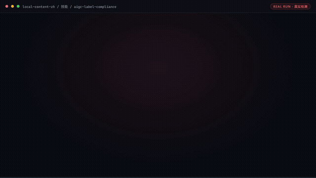

# 探店编导

> **门店的"编外内容总监"：每天给出拍什么、怎么拍、怎么挂团购的完整答案**



*▲ 真实执行录播（自动循环播放）· [▶ 观看完整版合集视频](docs/demo.mp4)*

[](https://github.com/bangwozuo)
[](#资产形态)
[](#资产形态)
[](LICENSE)

*上面 20 秒轮播本仓 5 个代表资产的真实执行截图：本地热点追踪（脚本实跑 8 条候选评分）、短视频脚本生成（296 字脚本 + 9 镜分镜）、探店脚本生成工作流（60s 配平 + 合规扫描）、每日热点选题工作流（6 选 3 选题卡）、口播文案+分镜工作流（语速/时间轴四道量化校验）。全部来自 `--run` 真实执行或实跑产物，非摆拍。*

---

## 它是谁

面向 **本地生活商家** 的数字员工资产包。

| 项目 | 内容 |
|------|------|
| 目标用户 | 无内容团队的餐饮/美业/健身门店老板（71% 无专业内容团队，据 R4 调研） |
| 一句话定位 | 门店的"编外内容总监"——选题、脚本、口播分镜、封面标题、发布排期、团购挂载一条龙 |
| 交付物（KPI） | 周产出可用脚本 ≥5 条；老板单条素材加工耗时 ≤20 分钟；内容更新频率 ≥3 条/周 |
| 资产数 | 5 个原子技能 + 5 条工作流 |
| 旧名存档 | `探店短视频编导` |

### 数字员工边界（做什么 / 不做什么）

| 做 | 不做 |
|---|---|
| 选题策划、脚本与口播文案、分镜建议、封面标题、发布排期、团购挂载建议 | 不代发布（发布动作留给老板一键完成） |
| 只服务餐饮/美业/健身到店场景，文案必须基于真实素材 | 不承诺播放量与涨粉，不做付费投流建议 |
| 输出以「今天就能拍」为完成标准 | 严禁虚构功效与虚假优惠 |

---

## 资产形态

**提示词为主 + 确定性脚本增强**：

| 特性 | 说明 |
|------|------|
| ✅ 无需 API Key | 一个 Key 都不需要 |
| ✅ 无需部署 | 提示词粘贴到任何 AI 工具即用 |
| ✅ 脚本可选增强 | 6 个资产带 `run_flow.py`/`hotspot_track.py`，做字数/评分/排期等确定性计算，产物落盘 xlsx/docx/png |
| ✅ 平台无关 | Coze / WorkBuddy / Dify / Claude / ChatGPT 均可 |
| ✅ 用户自备算力 | 模型来自你自己的订阅 |

---

## 快速开始

```text
1. 从下方技能清单/工作流清单选一个资产，打开其 prompt.txt
2. 全文复制
3. 粘贴到你常用的 AI 工具（Coze / WorkBuddy / Dify / Claude / ChatGPT）
4. 按 schema.json 的输入规格提供数据
```

带脚本的资产可零 AI 直接跑（确定性计算）：

```bash
python skills/local-hotspot-track/scripts/hotspot_track.py --demo
python workflows/storevisit-script-generate-flow/scripts/run_flow.py --demo
```

完整指引见 [使用手册](docs/04-usage.md)。

---

## 仓库结构

```text
local-content-zh/
├── README.md / employee.md / package.yaml     # 入口与 12 字段定义卡
├── docs/                                      # 员工级文档 + demo.mp4
├── skills/                                    # 5 个原子技能
│   └── <skill>/
│       ├── README.md  SKILL.md  prompt.txt  schema.json  examples/
│       ├── scripts/（部分资产）                # 确定性计算脚本
│       └── docs/ + out/                       # 配套文档 + 实跑产物
├── workflows/                                 # 5 条工作流（复合技能，均带编排脚本）
│   └── <workflow>/
│       ├── README.md  SKILL.md  prompt.txt  schema.json  examples/
│       ├── scripts/run_flow.py
│       └── docs/ + out/
├── knowledge/                                 # RAG wiki 知识库
├── connectors/                                # 连接器说明 + 合规红线
├── quality/                                   # 效果基线与追踪日志
└── tests/                                     # 资产校验测试（离线，无需密钥）
```

---

## 交付物导航

| 文档 | 内容 |
|------|------|
| [业务架构](docs/01-architecture.md) | 四层架构 + 数据流 + 能力边界 |
| [工作流流程](docs/02-workflow.md) | 5 条工作流的 DAG 可视化 |
| [使用场景](docs/03-scenarios.md) | 3 个真实场景（含前后对比） |
| [使用手册](docs/04-usage.md) | 各平台导入指引 + 常见问题 |
| [示例库](docs/05-examples.md) | 5 组输入输出示例 |
| [录像脚本](docs/06-recording-script.md) | 7 镜头分镜 + 旁白稿 |
| [校验报告](docs/07-test-report.md) | 资产质量校验结果 |

---

## 技能清单（5 个）

| # | 技能 | 能力族 | 复杂度 | 提示词 | 文档 |
|---|------|--------|--------|--------|------|
| 1 | 短视频脚本生成 | 脚本与分镜生成 | `S` | [prompt.txt](skills/shortvideo-script-generate/prompt.txt) | [docs](skills/shortvideo-script-generate/docs/) |
| 2 | 本地热点追踪 | 数据采集 | `M` | [prompt.txt](skills/local-hotspot-track/prompt.txt) | [docs](skills/local-hotspot-track/docs/) |
| 3 | 团购挂载文案 | 脚本与分镜生成 | `S` | [prompt.txt](skills/groupbuy-attach-copy/prompt.txt) | [docs](skills/groupbuy-attach-copy/docs/) |
| 4 | 多平台规格适配 | 改写与适配 | `S` | [prompt.txt](skills/multi-platform-spec-adapt/prompt.txt) | [docs](skills/multi-platform-spec-adapt/docs/) |
| 5 | AIGC 标识合规 | 合规校验 | `S` | [prompt.txt](skills/aigc-label-compliance/prompt.txt) | [docs](skills/aigc-label-compliance/docs/) |

## 工作流清单（5 条）

| # | 工作流 | 阶段 | 复杂度 | 触发 | 定义 | 文档 |
|---|--------|------|--------|------|------|------|
| 1 | 每日热点选题 | `P0` | `S` | 定时（每日 7:00） | [SKILL.md](workflows/daily-hotspot-topic-flow/SKILL.md) | [docs](workflows/daily-hotspot-topic-flow/docs/) |
| 2 | 探店脚本生成 | `P0` | `S` | 人工（老板投喂素材照片/语音描述） | [SKILL.md](workflows/storevisit-script-generate-flow/SKILL.md) | [docs](workflows/storevisit-script-generate-flow/docs/) |
| 3 | 口播文案+分镜 | `P0` | `S` | 人工（随 W2 联动） | [SKILL.md](workflows/voiceover-storyboard-flow/SKILL.md) | [docs](workflows/voiceover-storyboard-flow/docs/) |
| 4 | 封面标题生成 | `P0` | `S` | 人工 | [SKILL.md](workflows/cover-title-generate-flow/SKILL.md) | [docs](workflows/cover-title-generate-flow/docs/) |
| 5 | 发布日历与复盘 | `P1` | `M` | 定时（每周一） | [SKILL.md](workflows/publish-calendar-review-flow/SKILL.md) | [docs](workflows/publish-calendar-review-flow/docs/) |

---

## 知识库与连接器

| 目录 | 说明 |
|------|------|
| [`knowledge/`](knowledge/README.md) | RAG wiki 知识库：填入业务信息可显著提升输出质量 |
| [`connectors/`](connectors/README.md) | 连接器说明：数据从哪来、怎么合规地来 |

---

## 资产校验

```bash
pip install -r requirements.txt
pytest tests/ -v
```

校验技能完整性、提示词结构、契约一致性、工作流 DAG、docs 完整性、知识库与连接器结构。
**不需要任何 API Key。**

---

## 合规声明

- ✅ 所有输出为 **AI 辅助生成**，交付前须人工审核
- ✅ 提示词内置**违禁词禁止清单**，符合《广告法》要求
- ✅ 遵循《人工智能生成合成内容标识办法》（2025-09-01 施行）与《互联网广告管理办法》第 9 条（探店合作标注）
- ✅ 连接器只走**官方 API** 或**用户导出数据**
- ✅ 所有对外发布动作**保留人工确认环节**

---

## 许可

[Apache-2.0](LICENSE) — 可自由使用、修改、商用

---

*由 bangwozuo 业务库自动生成 · 2026-09-29 · README 多媒体化改造 2026-10-03*
